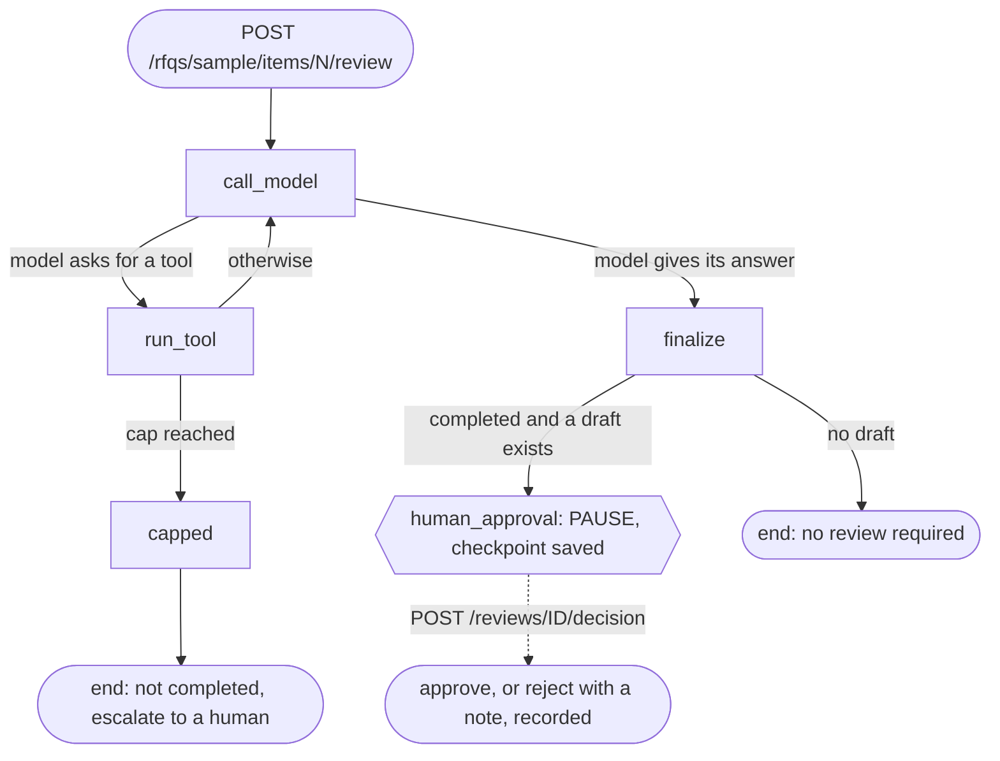

# RFQ AI — AI-Assisted Procurement Workflow System

> *An AI-assisted system that transforms a repetitive, manual procurement process into a semi-automated pipeline — where the human only makes the decisions that matter.*

An AI-assisted workflow automation project for industrial RFQ processing. It parses RFQ-style input, validates key procurement fields, discovers likely suppliers from a local knowledge base, generates supplier-specific RFQ email drafts, and keeps the human in control before any supplier communication is sent.

---

## Project Status / Data Disclaimer

This is a public portfolio project inspired by real procurement workflow experience. It was built independently and uses mock or sanitized RFQ-style data for demonstration.

It was not deployed at DECI and does not contain confidential company, client, supplier, pricing, or RFQ data. The email-generation module's company name is a configurable environment variable (`COMPANY_NAME`), not a hardcoded employer name, for the same reason.

## What This Demonstrates

- Practical workflow automation for an enterprise procurement process
- Deterministic-first engineering: rules and validation before AI assistance
- Human-in-the-loop checkpoints for supplier selection and email review
- Modular Python architecture: parser, supplier discovery, email generator, sender abstraction
- Testable components with schemas, logging, mock sender, and audit-trail outputs
- API boundary design using FastAPI, Pydantic response schemas, and JSON contracts
- Lightweight frontend review dashboard using HTML/CSS/JavaScript and `fetch()`
- Automated testing with pytest (147 tests), an evaluation harness, and CI on every push
- A lightweight SQLAlchemy repository layer over a supplier database
- A real, structured-output LLM analyzer (Claude Haiku 4.5) with an enforced human-review guardrail, measured against a deterministic baseline
- A multi-step, tool-calling agent (Claude Sonnet 5) that searches for suppliers, checks staleness, and drafts outreach email — with no send-email capability anywhere in its tool set
- Local semantic retrieval (`sentence-transformers`, no API cost) as a calibrated fallback when no manufacturer signal exists at all, wired into both the API and the agent
- A Docker image with the full dependency stack — including local retrieval — built, debugged, and verified end to end, with CI now building and smoke-testing it on every push
- A working local Kubernetes deployment (`kind`) — Deployment, Service, and Secret, with health-check probes reusing the same `/health` endpoint Docker's CI already relies on, verified end to end as of Phase 16 (see "Kubernetes" for what has not been re-verified since) and including a real production-shaped bug found and fixed along the way
- Supplier quotation document ingestion (PDF, DOCX) via Docling, structured into a validated schema by Claude — the first file-upload endpoint in the API — with measured field-extraction accuracy (8/8 cases, 100%) against a hand-labelled test set, the same rigor applied to every other AI component here
- The supplier-search agent rebuilt as a LangGraph graph with a durable human-approval pause: a drafted email stops the run, the state survives a restart (a pending review was read back from a container recreated from scratch), and a person approves or rejects with a reason — with an honest account of what the framework costs and where the plain loop would have been enough

## What Is This?

Every day, procurement engineers receive purchase requests from industrial clients. For each request, they must:

1. Read a complex Excel spreadsheet from SAP Ariba
2. Identify the right manufacturers and part numbers
3. Search their inbox and memory for past supplier contacts
4. Write and send individual RFQ (Request for Quotation) emails to each supplier

For a single RFQ with 10 line items across 5 manufacturers, this can mean **hours of repetitive manual work** — copying data, formatting emails, and deciding which suppliers to contact.

**This system semi-automates that entire workflow.** It reads the Excel file, finds the right suppliers, writes the emails, and creates ready-to-send Outlook drafts — all with a single command. The engineer reviews, edits if needed, and clicks send.

Think of it like a QC analyst's lab software: the system runs the process automatically and only asks the human to intervene at the moments that genuinely require judgment.

---

## Why I Built This

I spent one year as a Procurement Engineer handling MRO (Maintenance, Repair & Operations) spare parts for GCC heavy industrial clients. The work involved real domain expertise — understanding manufacturers, supply chains, lead times, compliance requirements — but much of the execution was repetitive.

I built this project for three reasons:

1. **To solve a real problem** — not a toy demo, but a system designed around actual daily workflows I extracted from my own work
2. **To demonstrate AI engineering** — showing where AI genuinely helps versus where deterministic code is smarter, more reliable, and easier to maintain
3. **To transition careers** — from Procurement Engineer to AI Workflow/Automation Engineer, with a portfolio piece that bridges both worlds

---

## Production-Oriented Workflow Design

This project is a portfolio implementation using mock and sanitized RFQ-style data. It was not deployed in a production environment, but it was designed around production-oriented workflow concerns: evaluation, observability, permission control, traceability, and human review.

The goal is not to build a fully autonomous procurement agent. The goal is to demonstrate how an AI-assisted workflow can support procurement engineers while keeping high-risk decisions under human control.

---

## API + Frontend Review Layer

In addition to the original command-line workflow, I added a lightweight API and browser review layer to make the RFQ workflow easier to inspect from a client interface.

This layer is intentionally small. It does not replace the core parser, supplier discovery, or email distribution modules. Instead, it exposes a sample RFQ review response through FastAPI and displays the result in a simple frontend dashboard.

### What the API Layer Demonstrates

- `GET /health` confirms that the FastAPI service is running.
- `GET /rfqs/sample` returns a structured sample RFQ parse response (status, warnings, next action, trace ID).
- `GET /rfqs/sample/items` returns line-item-level detail (material number, description, manufacturer, part number, UOM, quantity, flags) for the sample RFQ. Items with no manufacturer or part number also carry a `suggestion` field — the output of the LLM analyzer described below.
- `GET /rfqs/sample/supplier-candidates` returns per-item supplier candidates: a (still mock) historical match for items with a known manufacturer, or a real semantic-retrieval match — with a genuine similarity score — for items with none. If nothing scores above the retrieval threshold, no candidate is returned for that item at all, rather than a forced guess.
- `GET /rfqs/sample/items/{line_item}/agent-search` runs the multi-step agent (see below) for one line item. Unlike every other endpoint here, this one makes real, paid API calls — not mock data.
- `POST /rfqs/sample/quotations` accepts a supplier's quotation document and returns it as a structured, validated record (see "Supplier Quotation Ingestion").
- `POST /rfqs/sample/items/{line_item}/review`, `GET /reviews/{trace_id}` and `POST /reviews/{trace_id}/decision` run the agent, pause for a human when it drafts an email, and record the human's decision (see "LangGraph: Human Approval with a Durable Pause"). The start route makes a real, paid agent run.
- Pydantic models define the external API response contract for each endpoint.
- Converter functions in `api/converters.py` map internal parser dataclasses into API-friendly JSON, so a future swap from mock data to the real SQLite supplier database only changes the converter body, not the routes.
- CORS middleware is enabled for local frontend-backend development.

### What the Frontend Demonstrates

The frontend is a lightweight HTML/CSS/JavaScript review dashboard. It calls the FastAPI backend using `fetch()`, receives JSON, and displays:

- RFQ number
- Parsing / validation status
- Number of items processed
- Validation warnings
- Next recommended action
- Trace ID for debugging
- A line-item table with material number, description, manufacturer, part number, UOM, quantity, and flags
- A supplier candidates table showing source (historical match vs. semantic fallback), staleness, and whether human review is required

Rows that require human review are visually flagged in both tables, so review priority is visible at a glance rather than buried in raw JSON.

This is not a full production frontend. It is a small review interface designed to demonstrate how a web or mobile-style client could consume the RFQ workflow through a REST API.

---

## AI-Assisted Item Analysis and Supplier-Search Agent

Everything above is deterministic. This section is where real LLM calls actually happen — and it's built in the same deterministic-first spirit: AI is introduced only at the exact point deterministic parsing has already failed, and every AI-derived result is unconditionally marked as requiring human review, regardless of confidence or completion.

### Structured item analysis

When the parser finds no manufacturer or part number for a line item, that description is passed to an analyzer that returns a validated structured result — never free text:

```json
{
  "possible_manufacturer": null,
  "possible_part_number": null,
  "confidence": "low",
  "reason": "The description is generic with no identifiable manufacturer, brand name, or part number specified.",
  "human_review_required": true
}
```

`confidence` is constrained to exactly `"low"`, `"medium"`, or `"high"` via a Pydantic `Literal` type — an invalid value is rejected, not silently accepted. `human_review_required` is forced to `true` after parsing regardless of what the model returns; a test (`test_model_cannot_disable_human_review`) proves the model cannot override this even when it explicitly tries to.

Two implementations share this contract and are interchangeable at the call site:
- **Mock** (`llm/ambiguous_item_analyzer.py`) — a hardcoded manufacturer list plus a part-number-shaped regex. No API calls, no cost.
- **Real** (`llm/claude_analyzer.py`, Claude Haiku 4.5) — an actual model call, validated against the same schema, with a safe fallback on any failure (network error, malformed JSON, schema violation). `get_analyzer()` returns whichever is available — the real analyzer when `ANTHROPIC_API_KEY` is set, the mock otherwise — so the same code path works locally, in CI, and in tests without branching anywhere else.

The prompt/validation logic lives in a provider-neutral core (`llm/analysis_core.py`) with zero import of the Anthropic SDK; `llm/claude_analyzer.py` is a thin adapter over it. Swapping providers means writing a new adapter against that core, not touching the prompt or validation logic.

**Measured, not assumed:** `eval/compare_analyzers.py` runs both analyzers against 11 hand-labelled cases (`eval/analyzer_cases.json`) covering clean extractions, partial matches, a brand name embedded in a part number, and a deliberate true negative (a generic description where the correct answer is "nothing identifiable"). Latest run:

```
                                mock    claude
first run (prompt v1)            46%       91%
after relabel + prompt v2        41%      100%
total cost (v2 run)           $0.0000   $0.0081
median latency (v2 run)           0ms     1.93s
```

The 46% → 91% run is the cleaner number: Claude's first pass, before anything was adjusted. The 100% comes after one mislabelled case was corrected and the prompt was changed for product-line designations like "S7-1200" while looking at these same 11 cases, so it is a tuned score, not an out-of-sample one. Cost and latency are from the second run.

This is not run in CI — it makes real, paid API calls. Run it by hand with `python eval/compare_analyzers.py`. Disagreements are recorded rather than smoothed over: the case notes (`eval/analyzer_cases.json`) and the prompt version history document a mislabelled case and a prompt gap around product-line designations like "S7-1200" that surfaced during this evaluation.

### The supplier-search agent

`agent/supplier_agent.py` is a genuinely multi-step, tool-calling agent (Claude Sonnet 5) — the project's only component where the model decides what to do next based on an intermediate result, rather than producing one structured answer from one input.

Given one RFQ line item, it can: search the supplier database by manufacturer, fall back to semantic retrieval when no manufacturer is known or found, check which suppliers haven't been contacted recently, call the structured analyzer above when the manufacturer is unknown, and draft — never send — a supplier outreach email. How many steps that takes isn't fixed in advance; the model chooses based on what each tool returns.

**Tools available to the agent** (`agent/tools.py`):
- `search_suppliers_by_manufacturer` — read-only database lookup
- `check_stale_suppliers` — read-only; defaults to the project's real 12-month staleness rule (computed in code) rather than leaving the model to invent a cutoff date
- `analyze_item_description` — delegates to the structured analyzer above, rather than trusting the agent's own free-form guess for a task that already has a tested, guardrailed component
- `search_suppliers_semantically` — Phase 14's fallback for items with no manufacturer signal at all; searches by description similarity, used only after manufacturer-based search has been tried (see "Semantic supplier retrieval" below)
- `draft_supplier_email` — a deterministic template fill (not an LLM call), consistent with the fixed-template approach the email module already uses

**There is no send-email tool, anywhere in the registry.** This is architectural, not a prompted instruction: a tool gated behind an approval flag is still a code path from the model to a real send, and a flag can be wrong or bypassed by a future change. Leaving the capability out entirely means there is no such path — the agent cannot send email under any circumstances, not "is told not to." `test_registry_has_no_send_email_tool` checks this mechanically.

**Safety properties enforced in code, not just prompted for:**
- A hard iteration cap — an agent that can call tools indefinitely can spend money indefinitely; `test_agent_stops_at_iteration_cap_instead_of_running_forever` proves the loop actually stops rather than trusting the model to stop itself.
- Every tool call is validated and dispatched by the application; an unknown tool name or malformed arguments returns a structured error to the model instead of crashing the loop.
- `human_review_required` is unconditionally `true` on every result — success, partial completion, or hitting the iteration cap all produce a valid, reviewable result, never an automatic action.

**Tracing:** every call the agent loop makes — and any nested call it triggers (calling `analyze_item_description` invokes the analyzer above) — logs under the same request `trace_id`, in the same `llm_calls.log` file, in call order. One `grep <trace_id> llm_calls.log` shows the full multi-step, multi-module trace for one request. A tool that raises an unexpected exception also leaves a full traceback in the log under that same `trace_id` (before Phase 18 only the message text reached the model and nothing was logged).

**Cost, measured from real runs, not estimated:** a single agent run typically costs $0.01–$0.03 and takes 5–15 seconds — roughly an order of magnitude more than the single-shot analyzer above, because every iteration resends the full conversation history and tool schemas, and Sonnet 5 costs more per token than Haiku. This is a deliberate tradeoff: the loop needs the stronger model for adaptive tool selection, the single-shot analyzer doesn't. `GET /rfqs/sample/items/{line_item}/agent-search` is the only endpoint in this API where that cost applies — every other endpoint here is free and near-instant.

### Semantic supplier retrieval

Everything above handles items where a manufacturer is either known or can be extracted by the structured analyzer. This section covers what's left: an item with genuinely no manufacturer signal at all, where the only thing left to search on is what the item actually *is*.

**How it works** (`retrieval/`): a local `sentence-transformers` model (`all-MiniLM-L6-v2`) embeds a small mock historical corpus (`retrieval/corpus.py` — 11 records of past RFQ items paired with the supplier that fulfilled them) and compares a new item's description against it by cosine similarity. No API call, no per-query cost — this runs entirely on the local machine after a one-time model download.

The corpus is deliberately not 11 unrelated entries. Three pairs are near-duplicates by design — the same product type from two different manufacturers (an ABB and a Schneider Electric circuit breaker; a John Crane and a Flowserve pump seal), and the same manufacturer across two different product types (an ABB breaker and an ABB drive) — because a corpus where everything is trivially distinguishable can't actually demonstrate discrimination. A real diagnostic run confirmed every near-duplicate pair was correctly told apart by the language in the query, not just by rough topic.

**Calibrated, not guessed:** the similarity threshold (`0.5`) was set from that real diagnostic run, not picked before anything was measured. Every genuine match scored 0.58 or higher; every true-negative query (something entirely unrelated to procurement) scored 0.14 or lower. `0.5` sits with real margin on both sides of that gap.

**Wired into the workflow (Phase 14b):** `GET /rfqs/sample/supplier-candidates` now calls this for real, for any item with no known manufacturer — replacing a hardcoded "Mock Semantic Candidate" stub that had sat unused since the very first week of this project (the response shape existed six months before the thing it described was ever built). If nothing scores above threshold, **no candidate is returned for that item at all** — correct abstention, not a fallback guess. In practice: the sample RFQ's "Seal kit for heat exchanger" item scores 0.57 against the corpus's *pump* seal records — genuinely the closest thing available, still an honestly weak match, not a confident one.

**A fifth agent tool (Phase 14c):** `search_suppliers_semantically` gives the multi-step agent access to this as an explicit fallback — used only after manufacturer-based search has been tried and found nothing. In a live run, the agent reached for it unprompted, reported both candidates with their similarity scores, and added reasoning the prompt never explicitly asked for: *"these relate to pump seals, not heat exchangers specifically, so they are weak evidence only."*

**A real concurrency bug, found by that same live run:** `check_stale_suppliers` crashed with `no such table: suppliers` — nothing to do with retrieval itself, but a SQLite concurrency issue. FastAPI runs synchronous routes in a thread pool, and SQLAlchemy's default pooling for SQLite `:memory:` silently gives every new thread its own separate, empty database. The bug had existed since Phase 13a; it only surfaced once a live request happened to land on a worker thread that had never touched the seeded data before. Fixed with `poolclass=StaticPool`, and reproduced in both directions — fails without the fix, passes with it — in a genuine multi-threaded test, the only test in this project where real threading is required for the test to mean anything.

**Measured with independently-designed cases (Phase 14d):** `eval/retrieval_hit_rate.py` answers a different question than the mechanism-level tests above — not "does retrieval work correctly" but "does adding it actually help across realistic queries." Nine cases, built before checking how any of them would score: four paraphrases into corpus categories the diagnostic run never stress-tested, two real descriptions reused from the analyzer's own eval set for continuity, and three genuine gaps (a flange gasket, armored cable, a safety relay) where the corpus has nothing relevant and the correct answer is no match at all. Result: 9/9 correct — 100% of cases expecting a match found one, 100% of cases expecting no match correctly abstained. Run it with `python eval/retrieval_hit_rate.py`.

### Example API Response

```json
{
  "rfq_number": "RFQ-DEMO-001",
  "status": "validation_warning",
  "items_processed": 2,
  "warnings": [
    {
      "line_item": 2,
      "field": "line_item",
      "message": "No manufacturer or part number extracted from description."
    },
    {
      "line_item": 2,
      "field": "sourcing_identifiers",
      "message": "No manufacturer or part number extracted; human review required."
    }
  ],
  "next_action": "review_required",
  "trace_id": "demo_run_001"
}
```

---

## Supplier Quotation Ingestion

Every section above handles the OUTBOUND half of the workflow — parsing the RFQ and finding a supplier to contact. This section builds the INBOUND half, for the first time in this project: a supplier's quotation document coming back, in whatever format and however it's formatted.

### Why this needed a different architecture than everything else

Every other AI component in this project is deterministic-first: parsing tries first, the LLM only fills a gap deterministic logic couldn't. Quotation extraction inverts that. A real diagnostic run against a genuine (non-scanned) PDF showed Docling's own text reconstruction collapsing paragraph line breaks ("From: X Date: Y Re: Z" all on one line) and, on a later document, joining words with no space at all ("UnitPrice", "EAUnit"). A supplier's actual document formatting is too unpredictable across different companies' house styles for any fixed regex to survive — so here, the LLM-assisted structuring step (`quotation_intake/`) is the *default* path, not a fallback, and that's a deliberate, tested decision, not an oversight.

### The schema: raw facts only, deliberately separate from comparison

`quotation_intake/schemas.py` defines `SupplierQuotation`, shaped by real procurement detail: price can be quoted per-unit or as a set total; manufacturer and distributor aren't always the same company; a quantity and a minimum order quantity are two different numbers that must not get confused with each other.

The schema captures only what the SUPPLIER'S document itself states — never whether it matches the original RFQ line, and never a unit-of-measure conversion (a "500 SET" quote needs domain knowledge about that specific part's packaging to compare against an RFQ asking for "1000 EA" — that belongs to a deliberately separate comparison module, not yet built). Same single-responsibility principle as `parser/schemas.py` vs. `parser/validators.py`.

Field names are reused verbatim from existing schemas where the same concept already exists (`part_number`, `manufacturer`, `uom`), not renamed, so a future comparison step can line fields up with no translation layer. `flags: List[str]` matches `LineItem`'s pattern, not `SupplierCandidateResponse`'s single `reason: str` — a real quotation can have several independent problems at once (a UOM mismatch *and* a missing certificate *and* a part-number concern), and a list keeps each one separately actionable. `human_review_required: bool = True` is unconditional, the same pattern held by every AI-touched schema in this project.

Certificates are deliberately v0: `CertificateMention` (name, status, additional_cost) only covers what a document can state about itself — included, available at a cost, or not available. Two real scenarios are explicitly out of scope for now, not silently dropped: a document that says nothing about certificates, resolved by a follow-up phone call, and a supplier who doesn't know and never gets back to you. Both are facts from a human process, not from reading a document once, and belong to a separate concern not yet built.

### The pipeline and the new endpoint

`quotation_intake/docling_extractor.py` wraps Docling's conversion (deterministic, no LLM); `quotation_intake/analysis_core.py` holds the provider-neutral prompt and parse/validate/fallback logic (same split as `llm/analysis_core.py` vs. `llm/claude_analyzer.py`); `quotation_intake/claude_extractor.py` is the thin Anthropic adapter, reusing `llm.schemas.CallMetrics` rather than inventing a second metrics schema.

`POST /rfqs/sample/quotations` is the first file-upload endpoint in this API — every other route is a parameterless `GET`. It's a plain synchronous `def` route, not `async def`, despite handling file I/O: Docling's conversion and the Anthropic call are both blocking, and Starlette already dispatches sync routes to a thread pool automatically — the exact mechanism every other route in this project already relies on, so no new async/threading pattern was needed. A genuinely unreadable file (Docling can't open it at all) returns a real `422` — broken input, not ambiguous content. A readable document the model can't confidently structure still returns `200`, flagged and `human_review_required`, the same degrade-gracefully pattern as every other AI-touched endpoint here.

### Four real bugs, found by actually running this, not assumed away

**The `torchvision`/`torch` ABI mismatch.** `docling` depends on `torchvision` separately from the `torch` version already pinned to PyTorch's CPU-only index (see "Why install PyTorch from a separate CPU-only wheel index?" above) — and the regular PyPI `torchvision` wheel is built against CUDA-capable `torch`, not the CPU-only variant actually installed. They looked version-compatible on paper; their compiled internals didn't match. Found via a real CI failure (`RuntimeError: operator torchvision::nms does not exist`), fixed by installing `torchvision` from the *same* CPU index as `torch`, in the same step.

**Missing X11/graphics system libraries.** The first real run of the new endpoint *inside Docker* failed with `libxcb.so.1: cannot open shared object file` — `opencv-python`, pulled in transitively through `docling` → `rapidocr`, dynamically links against X11 libraries at import time even though this container never displays anything. Fixed by extending the Dockerfile's existing `apt-get` step (already installing `libgomp1`) with the complete, well-documented set this class of error is known to need (`libgl1`, `libglib2.0-0`, `libxcb1`, `libsm6`, `libxext6`, `libxrender1`) in one pass, rather than discovering them one at a time across repeated rebuilds.

**A missing `.env` load in the eval script itself.** The first run of `eval/quotation_extraction_eval.py` reported 10% field accuracy — every Claude call had actually failed with an authentication error, and the handful of "correct" fields were coincidental matches on fields that happened to expect `null`. The script was built by copying `eval/retrieval_hit_rate.py`'s shape, which never needed `load_dotenv()` since retrieval makes no API calls at all — `eval/compare_analyzers.py`, which does, already had the right precedent and should have been checked instead. A real reminder that even a test harness needs the same scrutiny as production code.

**A real violation of the "never compute a value" instruction.** Once the API key issue was fixed, one of eight cases failed: a document stating only a total price, for a line item also stating a quantity, came back with a *computed* `unit_price` — the model divided the two numbers despite an explicit prompt instruction not to infer unstated values. Fixed by adding a concrete, named example of the exact mistake to the prompt rather than relying on the general instruction alone; re-run confirmed the fix without disturbing any of the seven cases that already passed.

### Measured, not assumed

`eval/quotation_extraction_eval.py` runs 8 hand-built cases (`eval/quotation_fixtures/`) against the real pipeline — a clean baseline, a column-aligned layout, a DOCX file, the total-vs-unit-price distinction, a certificate quoted at a cost, no certificates mentioned at all, a minimum order quantity that differs from the quoted quantity, and a document with no price at all. Latest run: **8/8 cases fully correct, 100% field accuracy, $0.0133 total cost.**

What this does and doesn't prove, stated plainly: every document is short, clean, native-digital text, authored with full knowledge of what the schema needed — not independently sourced the way the retrieval eval's cases were. No scanned or genuinely messy real-world document has been tested; Docling's OCR path (`RapidOCR`) has never actually been exercised in this project. 100% here is a real, earned result on exactly what it tested, not a claim about robustness against real-world document variety beyond that.

---

## LangGraph: Human Approval with a Durable Pause

Phase 18 rebuilt the Phase 13 agent loop as a LangGraph graph and used it for exactly one thing the plain loop cannot do: **stop for a human, and pick up later — even after the process has been destroyed.** When the agent drafts a supplier email, the run pauses, its state is written to disk, and nothing continues until a person approves it or rejects it with a reason.

### Why LangGraph, and where the plain loop would have been enough

The graph is not shorter or simpler than the loop it replaced. The loop itself is 146 lines of code against 115 (about 27% more), because state that a `for` loop keeps in local variables has to be passed through explicitly; the whole stack — graph, review entry points, checkpointer — is 442 lines. It also adds a dependency and a new class of bugs (below). Without the pause, I would have kept the plain loop. The reason to use a graph here is state that is checkpointed and outlives the process, which a `for` loop cannot offer.

### The graph



`call_model` and `run_tool` carry the original loop; `finalize` and `capped` produce the two kinds of result the old loop could return; `human_approval` is new and exists only when the review flow asks for it. The Anthropic client is not part of the saved state; the dispatcher, prompt, parser and task builder are reused from the original agent rather than copied.

### Refactor first, proven three ways

Before adding the pause, the loop was rebuilt with no new behavior, so that any difference could be blamed on the framework and nothing else.

- **Scripted parity (19 tests).** The same scripted model responses are fed to both implementations and their results are compared field by field, along with the request sent to the model on every call and the conversation it sees. Breaking the graph on purpose (an off-by-one in the cap, a wrong `completed` flag, re-enabling parallel tool use, a limit equal to the cap) was caught every time.
- **Identical requests.** Capturing the real request bodies through the SDK showed one difference: the original loop echoes a `"citations": null` field on text blocks that the graph omits. Text, tool ids, names and inputs are identical.
- **A live comparison (12 real runs, $0.41).** Each of four items ran through the old loop twice and the graph once, because the model is non-deterministic and one run each proves nothing. The old loop agreed with itself on 2 of 4 items; old and graph agreed on 1 of 8 comparisons. That is not a clean pass and I do not present it as one: exact tool sequences vary even run to run, and two of the twelve runs were damaged by a parser bug (below). The structural proofs carry the parity claim; the live run shows the graph works against the real API and costs the same ($0.033 per run against $0.034). One graph run wandered to the cap and returned a clean, reviewable `completed=false` result — the cap working live.

### The cap is enforced by our router, not the framework

The framework's own `recursion_limit` raises an exception and discards the partial run; the original loop instead returned a valid, reviewable result when it hit its cap. So the cap lives in state and is checked by a router, which sends a capped run to a node that builds that same result. `recursion_limit` stays as a backstop, set from the cap: the worst legitimate path is 2N + 1 steps (N model calls, N tool runs, one capped node), so the limit is 2N + 5. The framework default in the installed version (1.2.14) is about 10,000 steps — measured, not the 25 older articles and docs state — which for a paid loop would mean thousands of model calls before anything stopped.

### The approval pause

- **When it pauses:** only when the run completed and produced at least one successful draft. A capped run, or a run with no draft, never pauses.
- **The node does nothing but ask.** LangGraph re-runs the node containing the pause from its first line on resume, so anything expensive before it would be paid for twice. A toy (`scripts/langgraph_toy_pause.py`) shows it: work placed inside the interrupt node ran twice; work in a separate node ran once.
- **State, not config.** `trace_id` lives in the saved state because a value passed only in call config is gone on resume unless every resume call supplies it again; `thread_id` equals `trace_id`, so one id finds the run in the logs, the checkpoint and the API.
- **Approve, or reject with a note.** A rejection without a note is refused before the run is touched and the run keeps waiting. Deciding twice, or deciding an unknown run, is refused without re-running anything.
- **Approval only records the decision.** Nothing in the graph, the tools or the API can send an email; the engineer still sends from Outlook. `human_review_required` stays `true` on the result after approval — the decision is a separate, recorded fact, and nothing is allowed to flip that flag.
- **Resuming cannot spend money.** It runs with a model client that raises if anything tries to call it, and a test makes building a real client fail loudly.

### Durable: a SQLite checkpointer

`make_sqlite_checkpointer` stores checkpoints in a SQLite file so a paused review and the later decision survive a restart. Two details come straight from earlier bugs: the connection needs `check_same_thread=False` because FastAPI runs routes on worker threads (a default connection fails with the same sentence as the earlier `StaticPool` bug; the saver adds its own lock), and the saver is built from an explicit connection because `from_conn_string` closes its connection when its `with` block ends. The database runs in WAL mode (the saver switches it on itself), and it assumes one process and one file.

It is proven at two levels. Tests treat "restart" as dropping every object and rebuilding from the file path alone. And on a real container: a review left waiting was read back, with the same draft, from a container recreated from scratch (the old one was 43 hours old), then approved, and the recorded decision read back again.

### The review API

| Route | What it does | Status codes |
|---|---|---|
| `POST /rfqs/sample/items/{n}/review` | Runs the agent (a real, paid run, about $0.03); pauses if it drafts | 200 `awaiting_approval` or `no_review_required`; 404 unknown item |
| `GET /reviews/{trace_id}` | The saved record: waiting, decided (with the note), no review needed, or incomplete (the process died mid-run) | 200; 404 unknown run |
| `POST /reviews/{trace_id}/decision` | `approve`, or `reject` with a note | 200; 404 unknown run; 409 not waiting; 422 invalid decision |

### Real bugs found along the way

- **A parser that threw away correct answers.** In the live comparison, 2 of 12 runs wrote a sentence before the JSON answer; the parser only handled a code fence at the very start, so it discarded the answer and reported `supplier_candidates_found=false` although suppliers were found. The bug dates from Phase 13. It is fixed once, in the function both loops share, with 6 regression tests.
- **The agent was never told the quantity.** The task message held the description and identifiers but not the RFQ quantity, and the draft tool requires a number, so a reviewer saw "Quantity: 1 EA" for an RFQ asking for 2 — and in the second live run the model's summary did not say it was a placeholder. Fixed with one shared task builder plus a prompt rule; a live run now drafts "2 EA".
- **A failing tool left no trace.** When a tool raised, the model saw only the message and the traceback was logged nowhere. It is now logged at ERROR with the run's `trace_id`.
- **The framework's default limit was not what I expected.** I predicted 25 from documentation; the installed version allows about 10,000. A test now checks the backstop stops a broken cap after a handful of steps.
- **Reusing a `trace_id`.** Starting a run under an id that already has a saved run is refused: the list reducers that append messages would otherwise carry the old run's history into the new one. (Reasoned from how the state is defined; the guard is tested, the merge itself was not reproduced.)
- **A stale `.env` in the WSL copy.** The container returned a 401 because the project exists in two copies (the Windows folder I edit and a WSL copy Docker builds from), and the WSL copy still held the old key. Environment variables are fixed when a container is created, so the container had to be recreated after syncing.
- **A gap in my own tests.** Every route test replaced the checkpointer dependency, so the real default path was never exercised until a container ran it. A test now drives a full request through it.

### Measured

| What | Result |
|---|---|
| Tests | 59 → 147 (88 added in Phase 18) |
| Cost per agent run | $0.033 graph vs $0.034 original loop (12 live runs); $0.02–$0.03 per review run |
| Median model latency | 12.0s graph vs 15.2s original over 4 and 8 runs — too few to read anything into |
| Loop size | 146 vs 115 code lines (+27%); whole stack 442 lines |
| Docker image | 2.31GB (1.61GB at Phase 15, before Docling) |
| Cold start | 18s unrestricted; 20s limited to 1 CPU and 2GB |
| Memory | about 512 MiB idle; peak 1542 MiB while processing one one-page PDF (a cgroup peak, which includes reclaimable file cache) |

### What this does not claim

It does not claim less code, or tool-for-tool identical behavior from a non-deterministic model. It has no authentication, so anyone who can reach the API can record a decision, and a saved decision records what was decided and why but not who decided or when. Approval covers a whole run, not each draft separately, and v0 has no editing. The second pause the design always had in mind — waiting for the supplier's quotation and then running the extraction — is not built, because the comparison step it would feed does not exist yet.

---

## Evaluation Approach

The system can be evaluated at multiple points in the RFQ workflow rather than only at the final output.

### 1. RFQ Extraction Accuracy

Module 1 parses RFQ-style input into structured fields such as RFQ number, client, material number, manufacturer, part number, description, quantity, and unit of measure.

Useful evaluation metrics include:

* Field-level extraction accuracy
* Missing-field detection rate
* Manufacturer extraction accuracy
* Part-number extraction accuracy
* Validation flag accuracy

Example bad-case categories:

* Missing manufacturer
* Missing part number
* Ambiguous manufacturer name
* Description-only item with no clear part number
* Replacement or superseded part reference
* Invalid quantity or unit of measure
* Incomplete RFQ metadata

This matters because downstream supplier discovery and email generation depend on clean structured data. If extraction fails silently, the system may contact the wrong supplier or generate an incomplete RFQ email.

### 2. Supplier Matching Quality

Module 2 searches a local supplier knowledge base and matches suppliers to manufacturer or material information.

Useful evaluation metrics include:

* Top-1 supplier match correctness
* Top-k supplier coverage
* Match source distribution: historical match, manufacturer fallback, AI suggestion, or manual entry
* Stale supplier detection rate
* Human override rate

Example bad-case categories:

* No supplier found for manufacturer
* Supplier found but marked stale
* Supplier matched by manufacturer but not by exact material number
* Duplicate supplier records
* Supplier country or contact information missing
* AI-suggested supplier requires human verification

This matters because supplier discovery is not only a search problem. It also involves trust, freshness, prior experience, and human judgment.

### 3. Human Edit Rate

The system should be judged not only by whether it produces an output, but by how much human correction is needed.

Useful metrics include:

* Percentage of generated emails edited by the user
* Average number of edited fields per draft
* Supplier list approval rate
* Supplier list override rate
* Number of RFQ items requiring manual review
* Number of drafts blocked before sending

A lower human edit rate suggests the workflow is reducing repetitive work effectively. A higher edit rate may indicate weak parsing, poor supplier matching, unclear email formatting, or missing business rules.

### 4. End-to-End Workflow Success

An end-to-end run can be evaluated by checking whether:

* The RFQ input is parsed without crashing
* Required fields are either extracted or flagged
* Supplier candidates are returned with evidence
* Email drafts are generated in the expected format
* No real email is sent without human review
* An audit trail is saved for later inspection

The evaluation goal is not to claim perfect automation. The goal is to make system behavior measurable, reviewable, and improvable.

### 5. Evaluation Harness (Implemented)

The categories above describe how the system *could* be evaluated at scale. A first, small version of that idea is already implemented in `eval/`:

- `eval/test_cases.json` defines known scenarios — a clean item, an item missing sourcing identifiers, and a semantic-fallback supplier candidate.
- `eval/run_eval.py` checks each case against the *actual* running API (via FastAPI's `TestClient`, in-process, no server required) rather than hardcoded values, so a real regression in the parser/converter logic causes a real test failure.
- Running it (`python eval/run_eval.py`) prints a pass/fail summary and writes `eval/eval_report.json`.
- A GitHub Actions workflow (`.github/workflows/eval.yml`) runs this automatically on every push — see Continuous Integration below.

This is intentionally v1 — three cases, checking the mock `/rfqs/sample*` endpoints rather than the real Excel parser or SQLite supplier database. It establishes the pattern (expected vs. actual, automated, catches regressions) that the broader evaluation categories above can grow into.

### 6. LLM Analyzer Evaluation (Implemented)

A second, separate evaluation harness (`eval/compare_analyzers.py`) measures the structured item analyzer specifically — field accuracy, cost, and latency, side by side against a deterministic baseline, on an 11-case hand-labelled dataset. See "AI-Assisted Item Analysis and Supplier-Search Agent" above for the current numbers and what the two disagreement cases revealed. This harness makes real, paid API calls and is run by hand, not in CI.

### 7. Semantic Retrieval Evaluation (Implemented)

Unlike every other AI component in this project, semantic retrieval needed no mocking to test for real: a local embedding model is deterministic (the same text always produces the same vector), so `tests/test_semantic_retrieval.py` asserts against real similarity scores directly — discrimination between near-duplicate corpus entries, correct rejection of true-negative queries, and the calibrated threshold itself, all checked against actual model output rather than assumed behavior. See "Semantic supplier retrieval" above for what those real scores were.

### 8. Semantic Retrieval Hit-Rate Measurement (Implemented)

A second, higher-level retrieval evaluation, distinct from the mechanism-level tests in section 7 above: `eval/retrieval_hit_rate.py` checks whether semantic fallback actually surfaces a usable candidate across a realistic spread of ambiguous items, not just whether the underlying similarity math is correct in isolation. See "Semantic supplier retrieval" above for the corpus design and the 9/9 result. Free and local, not run in CI.

### 9. Quotation Extraction Accuracy (Implemented)

A third real-document-accuracy harness, alongside sections 6 and 8 above: `eval/quotation_extraction_eval.py` measures the Docling + Claude quotation pipeline against 8 hand-built documents covering format variety (PDF, DOCX, a column-aligned layout) and specific real-world gotchas (unit vs. total price, a certificate with a stated cost, a minimum order quantity distinct from the quoted quantity). See "Supplier Quotation Ingestion" above for the full result and what it does and doesn't prove. Makes real, paid Claude calls; not run in CI.

### 10. Original Agent Loop vs LangGraph Version (Implemented)

Two layers, because the model is non-deterministic. `tests/test_supplier_graph.py` runs the same scripted responses through both implementations and compares results field by field — free, and part of the pytest suite. `scripts/compare_agent_vs_graph.py` runs real calls (old loop twice, graph once, per item) so that old-versus-old disagreement gives a noise baseline to judge the graph against. About $0.40 per run; not in CI. See "LangGraph: Human Approval with a Durable Pause" for the result and what it does and doesn't prove.

---

## Observability and Logging

The project uses logging and JSON outputs to make workflow behavior inspectable. In a production enterprise workflow, observability is important because silent failures can create operational risk.

**What is implemented today:** rotating file loggers in Modules 1 and 3, and — for the API and agent — a `trace_id` system with structured per-call logging to `llm_calls.log` (see "Tracing a suggestion to its model call" below). **What follows is the target design** for a production workflow, not a description of everything already built.

For each workflow run, the system should ideally record:

* Input file name or RFQ identifier
* Parsed RFQ metadata
* Number of line items processed
* Number of validation warnings
* Supplier matching source for each item or manufacturer
* Generated draft count
* Execution time per module
* Errors or exceptions
* Human intervention points
* Final user decision: approved, edited, skipped, or blocked

Example log events:

* RFQ file received
* RFQ parsing started
* RFQ parsing completed
* Validation warning generated
* Supplier lookup started
* Supplier found from history
* Supplier marked stale
* AI suggestion requested
* Human approval required
* Email draft generated
* Email sending blocked pending review
* Audit trail saved

This makes the system easier to debug and safer to operate. Instead of only seeing the final draft, the user can understand what happened at each step.

### Tracing a suggestion to its model call

Every `/rfqs/sample/items` request generates a `trace_id`, shown in
the API response and under the dashboard's line-items table. Each
model call made while building that response logs one structured line
to `llm_calls.log` carrying the same id — with prompt version, token
counts, cost, latency, and outcome:

    grep "items_45a4faeaf6bb" llm_calls.log

The same file also carries the agent's multi-step traces — an agent run's own iteration and tool-call lines, and any nested analyzer call it triggers, all under one `trace_id`:

    grep "agent_9d982330befd" llm_calls.log

No external observability platform is used; the log format is designed
so a Langfuse-style tool could be added later without changing the
instrumentation points.

---

## Safety and Permission Model

The system is intentionally designed as a human-supervised workflow, not a fully autonomous procurement agent.

### Automatic Read Actions

The system can safely perform read-only actions such as:

* Reading mock RFQ-style input files
* Parsing structured RFQ fields
* Searching a local supplier knowledge base
* Reading historical supplier records
* Loading email templates
* Loading validation rules

These actions do not create external business impact.

### Automatic Low-Risk Actions

The system can automatically perform low-risk internal actions such as:

* Generating structured JSON output
* Creating validation warnings
* Ranking supplier candidates
* Grouping RFQ line items by manufacturer
* Generating draft email content
* Saving logs and audit trails

These actions support the human user but do not contact suppliers or commit business decisions.

### Approval-Required Actions

The following actions require human approval:

* Selecting final suppliers to contact
* Using stale supplier records
* Accepting AI-suggested suppliers
* Adding new supplier records to the knowledge base
* Attaching files to RFQ emails
* Sending RFQ emails externally
* Proceeding when required RFQ fields are missing or ambiguous

These steps involve supplier relationships, commercial risk, or incomplete data, so the human remains responsible.

### Prohibited Actions

The system should not:

* Send emails without human review — for the Phase 13 agent specifically, this isn't just a stated rule: there is no send-email tool defined anywhere in its tool registry, so no code path exists from the model to a real send, regardless of prompt or model behavior.
* Invent missing supplier contact details
* Invent manufacturer names, part numbers, prices, certificates, or lead times
* Override validation warnings without user confirmation
* Access confidential company systems without authorization
* Store confidential client, supplier, pricing, or RFQ data in the public/demo version

This permission model keeps the system useful while reducing the risk of incorrect or unauthorized actions.

---

## Traceability and Explainability

Each recommendation or warning should be explainable to the user.

For supplier selection, the system should show:

* Which supplier was selected
* Which manufacturer or material number triggered the match
* Whether the match came from historical data, manufacturer fallback, AI suggestion, or manual entry
* Whether the supplier is stale
* What human approval is required before proceeding

For validation failures, the system should show:

* Which RFQ line item failed validation
* Which field is missing or ambiguous
* Why the issue matters
* Whether the workflow can continue or should pause for review

For human approval, the system should show:

* What action is being requested
* Why approval is required
* What evidence the system used
* What the risk is if the user proceeds

This makes the workflow easier to trust. The user is not asked to blindly accept an AI recommendation; they are shown the evidence and the reason for review.

---

## Feedback Loop

The workflow can improve over time through human feedback.

*Status: design intent. The only part implemented so far is Module 2's write-back of human supplier decisions into the knowledge base; structured capture of the other feedback below is not built yet.*

Examples of useful feedback include:

* User accepts a supplier recommendation
* User rejects a supplier recommendation
* User marks a supplier as stale or no longer useful
* User manually adds a better supplier
* User edits generated email wording
* User flags missing manufacturer or part-number information
* User blocks an email draft before sending

This feedback can be used to improve:

* Supplier ranking
* Supplier freshness rules
* Manufacturer normalization
* Validation rules
* Email templates
* Bad-case handling

The important design principle is that feedback should be captured as structured workflow data, not only as informal user memory. This allows future evaluation and improvement without making the system fully autonomous.


---

## The Core Design Philosophy

### 1. Deterministic First, AI Only Where Needed

Many "AI projects" add AI everywhere. This one doesn't. AI is introduced only where human-like judgment is genuinely required — specifically, where the data is too ambiguous or unstructured for rules to handle reliably.

| Task | Approach | Why |
|------|----------|-----|
| Parse Excel structure | Deterministic | Structure is consistent |
| Extract part numbers | Deterministic | Clear pattern (e.g. `LU400/H - GE LIGHTING`) |
| Identify ambiguous manufacturer names | AI-assisted | Requires domain knowledge |
| Suggest new suppliers | AI-assisted | Open-ended discovery task |
| Generate email subject/body | Deterministic | Fixed template + structured data |
| Select email signature | Deterministic | Simple rule (country → signature) |

### 2. Human-in-the-Loop

The system never sends emails automatically. At every critical decision point, it pauses and asks the engineer:

- Is this supplier list correct?
- Do you want to include stale suppliers?
- Do you have attachments to add?

This is intentional. Procurement involves real money and real relationships. The human stays in control.

In the API layer this is no longer only a convention: as of Phase 18, a drafted email makes the run actually stop — its state is saved to disk and nothing continues until a person approves it, or rejects it with a reason. See "LangGraph: Human Approval with a Durable Pause".

### 3. Modular Architecture

The system is split into three independent modules, each with clear inputs and outputs. Modules can be tested, updated, or replaced without touching the others.

### 4. Simple Infrastructure

SQLite for storage, Python standard library where possible, win32com for Outlook integration. The right tool for the right job — not the most impressive tool.

This principle held even once Docker and Kubernetes entered the picture (Phases 15–16): both were added deliberately, as a learning exercise in the deployment model, not because an 11-record demo workload actually needs a container orchestrator. `kind` over a managed cluster, `ClusterIP` over `NodePort`, one replica, no ingress controller — every choice stayed as minimal as the thing being demonstrated required, the same instinct that picked SQLite over PostgreSQL back in Module 2.

---

## System Architecture

```
┌─────────────────────────────────────────────────────────────┐
│                        USER INPUT                           │
│              Path to SAP Ariba Excel (.xlsm)                │
└─────────────────────┬───────────────────────────────────────┘
                      │
                      ▼
┌─────────────────────────────────────────────────────────────┐
│                     MODULE 1                                │
│                  RFQ Parser & Validator                     │
│                                                             │
│  • Reads SAP Ariba XLSM file                               │
│  • Extracts metadata (RFQ number, client, date)            │
│  • Parses line items (material, description, UOM, qty)     │
│  • Extracts part numbers & manufacturers                   │
│  • Flags ambiguous or missing data                         │
│  • Writes Excel comments for human review                  │
│                                                             │
│  Output: parsed_<rfq_number>.json                          │
└─────────────────────┬───────────────────────────────────────┘
                      │
                      ▼
┌─────────────────────────────────────────────────────────────┐
│                     MODULE 2                                │
│                  Supplier Discovery                         │
│                                                             │
│  • Searches SQLite knowledge base by material number       │
│  • Falls back to manufacturer name if no history           │
│  • Flags stale suppliers (>12 months since last contact)   │
│  • AI layer suggests new suppliers for unknown items       │
│  • Human reviews, selects, and adds new suppliers          │
│  • Saves all decisions to knowledge base for future use    │
│                                                             │
│  Input:  parsed_<rfq_number>.json                          │
│  Output: suppliers_<rfq_number>.json                       │
│  DB:     knowledge_base/suppliers.db (SQLite)              │
└─────────────────────┬───────────────────────────────────────┘
                      │
                      ▼
┌─────────────────────────────────────────────────────────────┐
│                     MODULE 3                                │
│                 Email Distribution                          │
│                                                             │
│  • Groups line items by manufacturer                       │
│  • Matches suppliers to each manufacturer group            │
│  • Generates per-supplier email drafts:                    │
│    - Subject: <Company> RFQ {ref} {client} - {MFR}        │
│    - Salutation: Dear Mike / Dear Sir/Madam (auto-detect)  │
│    - Body: fixed template + line item table                │
│    - Signature: Ireland or Saudi (based on supplier country)│
│  • Creates Outlook drafts automatically                    │
│  • Saves audit trail JSON                                  │
│                                                             │
│  Input:  parsed_<rfq_number>.json +                        │
│          suppliers_<rfq_number>.json                       │
│  Output: Outlook Drafts + send_results_<rfq_number>.json   │
└─────────────────────┬───────────────────────────────────────┘
                      │
                      ▼
┌─────────────────────────────────────────────────────────────┐
│                   HUMAN REVIEW                              │
│                                                             │
│  Engineer reviews drafts in Outlook                        │
│  Edits if needed → clicks Send                             │
└─────────────────────────────────────────────────────────────┘
```

---
### API / Frontend Review Flow

```text
Browser Review Dashboard
        │
        │  JavaScript fetch()
        ▼
FastAPI REST API
        │
        │  GET /rfqs/sample
        ▼
API Response Schema
        │
        │  Pydantic response model
        ▼
Converter Layer
        │
        │  internal parser dataclass → API-friendly JSON
        ▼
Parsed RFQ Review Response
        │
        ▼
Human reviews status, warnings, next action, and trace ID
```

---

## Key Technical Decisions & Tradeoffs

### Why SQLite instead of PostgreSQL or Oracle?
Oracle requires significant infrastructure and IT authorisation. PostgreSQL needs a server. SQLite is a single file, zero setup, runs anywhere. For a personal workflow tool processing tens to hundreds of RFQs, SQLite is the right choice — simple, reliable, portable.

### Why not just use ChatGPT for everything?
Because reliability matters more than impressiveness. A deterministic function that builds an email subject line will always produce the correct format. An LLM might hallucinate a field, change the format, or fail unpredictably. AI is reserved for tasks where deterministic rules genuinely cannot work — like identifying manufacturer names from messy, unstructured text.

### Why three separate modules?
Each module has a single responsibility and can be tested, updated, or replaced independently. If the email template changes, only Module 3 needs updating. If the supplier database schema changes, only Module 2 is affected. This is the separation of concerns principle in practice.

### Why human-in-the-loop at every stage?
Procurement involves real supplier relationships and real money. An automated system that sends the wrong email to the wrong supplier causes real damage. The system is designed to be a powerful assistant, not an autonomous agent.

### Why an email sender abstraction layer?
The `email_sender/` module defines a base interface (`BaseEmailSender`) that any email provider can implement. Currently supports Outlook (via `win32com`) and a Mock sender (for testing). Adding Gmail or another provider in future requires zero changes to the rest of the codebase — just a new implementation file.

### Why Sonnet 5 for the agent loop but Haiku 4.5 for single-item analysis?
Deciding which tool to call next based on an intermediate result is a harder reasoning task than single-shot field extraction. Haiku is fast and inexpensive for the narrow, well-specified analysis task; Sonnet 5 is reserved for the agent loop, where the stronger model's cost (roughly an order of magnitude higher per run, measured directly from live runs) buys better tool-selection judgment rather than being spent on a task that didn't need it.

### Why no send-email tool for the agent, rather than an approval flag?
A tool gated behind an approval flag is still a code path from the model to a real send — the flag could be wrong, forgotten, or bypassed by a future change. Leaving the capability out of the tool registry entirely means no such path exists at all. The agent can draft an email for human review; sending is a manual action outside its reach, by construction rather than by instruction.

### Why local embeddings (sentence-transformers) instead of a hosted vector database or API-based embeddings?
No API cost, no network dependency after the model is cached once, and a brute-force cosine similarity search is genuinely fine at this corpus size (11 records). A real vector database (FAISS, Pinecone) would be solving a scale problem this project doesn't have yet.

### Why does semantic search only fire after manufacturer-based search fails?
Same deterministic-first priority used everywhere else in this project: exact/manufacturer matching is more reliable when it's available, so semantic retrieval is a fallback for when there's nothing else to search on, never a first choice.

### Why does agent/tools.py's database engine use StaticPool?
A real live agent run crashed with `no such table: suppliers` — not a retrieval bug, a SQLite concurrency one. FastAPI runs synchronous routes in a thread pool, and SQLAlchemy's default pooling for SQLite `:memory:` gives every new thread its own separate, empty database. `StaticPool` shares one real connection across every thread instead — the standard fix, verified with a genuine multi-threaded test that fails without it and passes with it.

### Why install PyTorch from a separate CPU-only wheel index?
The default PyPI `torch` wheel on Linux bundles the full NVIDIA CUDA runtime by default, on the assumption a GPU might be present. This container has no GPU, and a similarity search over an 11-record corpus wouldn't benefit from one even if it did — installing from PyTorch's dedicated CPU index (`download.pytorch.org/whl/cpu`) avoided several gigabytes of genuinely unused dependencies, cutting the final image from a likely 5-6GB down to a measured 1.61GB at the time (2.31GB today, after Docling was added).

### Why did the Docker build need to happen from WSL2's own filesystem, not the Windows-mounted drive?
Every file Docker reads to build its context crosses WSL2's Windows/Linux filesystem boundary when the project lives under `/mnt/d`, and that boundary carries a real, well-documented performance cost for workloads with many small files — a Python venv with PyTorch installed is close to a worst case. `docker build` (and a plain `du -sh` on the same folder) hung for the better part of an hour before the fix: copying the project into WSL2's native filesystem first, the standard Microsoft-documented practice for exactly this situation.

### Why `imagePullPolicy: Never` in the Kubernetes manifest?
With a `:latest` tag and no explicit override, Kubernetes defaults to `imagePullPolicy: Always` — meaning it ignores an image already loaded locally (via `kind load docker-image`) and tries to pull from a public registry instead, failing immediately since the image only exists on this machine. A well-documented `kind`-specific trap, fixed before it was ever hit rather than after.

### Why `ClusterIP` and `kubectl port-forward` instead of `NodePort`?
`NodePort` has real friction specifically under `kind` (its own documentation recommends `port-forward` or extra cluster configuration for a smooth local experience). `ClusterIP` is Kubernetes' own default and the textbook-minimal way to expose a service — the right amount of infrastructure for demonstrating the model, not the most direct route to a public port.

### Why does the agent's parse-failure logging matter more than it looks?
A live Kubernetes run hit a real, pre-existing gap: the code silently defaulted to an empty string when a model response had no `text` content block, and the error handling only logged the resulting exception, never what actually caused it. The fix — log the raw text on a parse failure, log which block types were present when there's no text at all — didn't change what the agent does when something goes wrong (it still degrades safely, same as before); it changed whether a *future* occurrence of this can actually be diagnosed instead of just observed.

### Why does `quotation_intake` use an LLM-assisted structuring step as the DEFAULT, not a fallback?
Every other AI component here tries deterministic logic first. A real test showed why this one is different: a supplier's PDF reconstructed by Docling can collapse "From: X Date: Y" onto one line, or join words with no space at all ("UnitPrice"). That kind of unpredictable, inconsistent formatting across different companies' documents is exactly what regex-based parsing can't reliably survive — an LLM reading for meaning, not matching literal strings, is the right default here, not a shortcut.

### Why does the quotation upload endpoint stay a plain sync `def` route?
Docling's conversion and the Anthropic call are both blocking. Making the route `async def` without offloading that work would freeze the event loop for every other request while one upload processes. Keeping it a plain sync `def`, like every other route in this project, means Starlette's existing automatic thread-pool dispatch handles the isolation with no new pattern introduced.

### Why does an unreadable file get a 422 but an ambiguous one get 200?
A document Docling genuinely can't open is broken input — a client-side problem, correctly a 4xx. A document that reads fine but that Claude can't confidently structure is a different kind of result: the same "ambiguous, flagged, human_review_required" outcome every other AI-touched endpoint in this project already returns as a 200. Conflating the two would mean treating normal, expected uncertainty the same as a malformed request.

### Why did `torchvision` need its own fix, separate from the earlier CPU-only `torch` fix?
Pinning `torch` to PyTorch's CPU index doesn't automatically mean every other package that also depends on `torch` gets a matching build. `docling` pulls in `torchvision` separately, and the regular PyPI wheel for it assumes CUDA-capable `torch` — installing both from the same CPU index together is what actually guarantees their compiled internals match.

### Why LangGraph for the agent loop, if the plain loop worked?
For one capability only: a run that stops for a human and resumes later, from state that outlives the process. The graph is about 27% more loop code than the plain loop and adds a dependency, so without that pause the plain loop would have stayed. The refactor was done first, with no new behavior, so any difference could be blamed on the framework.

### Why is the iteration cap enforced by our own router, not LangGraph's `recursion_limit`?
Hitting the framework's limit raises an exception and discards the partial run, while the original loop returned a valid, reviewable result at its cap. A router in the graph sends a capped run to a node that builds that same result. `recursion_limit` remains as a backstop set from the cap (2N + 5, against a worst legitimate path of 2N + 1), because the installed version's default is about 10,000 steps.

### Why does the approval node do nothing except ask?
LangGraph re-runs the node containing the pause from its first line when the run resumes, so any expensive work placed before the pause would be paid for twice. The node therefore only builds the review request from saved state, pauses, and records the answer.

### Why does `trace_id` live in the graph's state, not in call config?
State survives the pause; a value passed only in config is gone on resume unless every resume call supplies it again. With `thread_id` equal to `trace_id`, one id finds the run in the logs, the checkpoint and the API.

### Why does the SQLite checkpointer need `check_same_thread=False`, and why not `from_conn_string`?
FastAPI runs routes on worker threads, and a default SQLite connection refuses to be used from any thread but its creator — the same failure behind the earlier `StaticPool` bug. The saver's internal lock makes the shared connection safe. `from_conn_string` is a context manager that closes its connection when the `with` block ends, which suits a script but not a server. The lock lives inside the process, so it assumes one process and one file.

---

## Containerization

The API and its full dependency stack — including local semantic retrieval — run in a Docker container, built and verified end to end: every endpoint tested inside the container, including a real Claude call, real embedding retrieval, and the full multi-step agent loop with its SQL-backed tools.

### What's in the image

The `Dockerfile` starts from `python:3.11-slim` (matching the Python version CI already used), installs `libgomp1` explicitly — a widely-documented gap in slim Debian images that breaks importing PyTorch with `libgomp.so.1: cannot open shared object file` if left unfixed — then installs dependencies, bakes the semantic retrieval embedding model into the image at build time, and copies in the application code.

**The embedding model is baked in at build time, not left to download on first request.** This is the standard production pattern for a service depending on a third-party model hub: the exact model version is pinned to the image build, and the running container has no runtime dependency on reaching Hugging Face at all — important in any environment with restricted network egress, and it avoids a container's first real request paying a multi-second download delay. Confirmed in practice: `GET /rfqs/sample/supplier-candidates` responds instantly inside the container, with the identical similarity score (`0.57` for the Flowserve match) it produces everywhere else this project has run it.

**Secrets are never baked into the image.** `.dockerignore` excludes `.env`; `ANTHROPIC_API_KEY` is passed at `docker run` time (`--env-file .env`, so the key never appears in a typed command or in shell history), the same principle established back when the real Claude analyzer was first wired in — a key baked into an image layer is recoverable by anyone who ever gets that image, even after a later layer appears to remove it.

### Two real bugs, found by actually building it

**PyTorch pulled in the full NVIDIA CUDA runtime by default.** The first real build correctly installed `sentence-transformers`, but its `torch` dependency resolved to the default PyPI wheel — which bundles the entire GPU/CUDA toolkit (`nvidia-cudnn`, `nvidia-cublas`, `nvidia-cusparse`, `triton`, and more), several extra gigabytes for hardware this container doesn't have and a workload that wouldn't benefit from a GPU even if it did. Fixed by installing from PyTorch's own dedicated CPU-only wheel index before installing the rest of `requirements.txt`, so the CPU build was already satisfied by the time `sentence-transformers` looked for `torch`. Measured effect: `1.61GB` at the end of Phase 15 (`2.31GB` today — see "After Phases 17–18" below).

**`docker build` silently hung for the better part of an hour**, with no error and no progress, because the project lived on a Windows-mounted drive (`/mnt/d`, accessed from WSL2), and every file Docker needed to read for the build context crossed WSL2's Windows/Linux filesystem boundary — a well-documented performance cliff for workloads with many small files. A plain `du -sh` on the same folder hung identically, which is what isolated the cause to filesystem access rather than anything Docker-specific. Fixed by copying the project into WSL2's own native filesystem before building. A second false trail during the same investigation — two long-forgotten virtual environments (`venv_wsl/`, `venv312/`) that had never come up before — turned out to be responsible for a 5.7GB `rsync` transfer; excluding them and deleting them from the copy brought it down to under 1MB of real project files.

### After Phases 17–18: what changed in the container

- **Size and startup.** The image is `2.31GB`; the growth coincides with adding Docling's dependency stack (I did not break it down layer by layer). The server is ready to answer `/health` after 18 seconds, and after 20 seconds when limited to 1 CPU and 2GB.
- **Memory.** About 512 MiB idle. Processing one one-page PDF peaked at 1542 MiB under a 2GB limit (no out-of-memory kill) — a cgroup peak, which includes reclaimable file cache, measured on a single small document; a longer document or two at once would use more.
- **Docling's own models are not baked in.** The embedding model is, but Docling downloads its layout and OCR models on the first upload, so a fresh container's first upload is slow and needs network access.
- **The review database lives on a named volume.** `-v rfq-review-data:/data` with `REVIEW_DB_PATH=/data/reviews.sqlite`. Removing the container does not remove the volume; WAL mode leaves `-wal` and `-shm` files beside the database, so a backup must take all three.
- **Environment variables are fixed when a container is created.** A real incident: after rotating the API key, the container still returned a 401 because the WSL copy of the project held the old `.env`. Editing `.env` changes nothing in an existing container: sync the file, `chmod 600` it (the sync copies the Windows drive's open permissions), and recreate the container.

### Continuous Integration

A second CI job, `docker-build`, runs in parallel with the evaluation harness on every push: builds the image, starts a container from it, and polls `GET /health` until it responds — or fails the job after 30 seconds if it never does — proving the container actually starts and serves a request, not just that the image built without error. It deliberately stops at `/health`: hitting any endpoint that makes a real Claude call would need `ANTHROPIC_API_KEY` as a GitHub secret and would add real cost to every single push, breaking the "CI stays free" principle this project has held since Phase 6.

---

## Kubernetes

The same image from "Containerization" above runs under a real, local Kubernetes cluster (`kind` — Kubernetes-in-Docker), not because this workload needs orchestration, but to demonstrate the deployment model: a `Deployment`, a `Service`, and a `Secret`, applied with `kubectl` and verified end to end against every endpoint — the exact same checklist used for Docker.

### What's deployed

`k8s/deployment.yaml` runs one replica of the image, with CPU/memory requests and limits set, and a `readinessProbe`/`livenessProbe` both pointed at `/health` — reusing the exact endpoint already built for Docker's own CI smoke test, rather than inventing a second health-check mechanism. `k8s/service.yaml` exposes it internally as a `ClusterIP`, reached locally via `kubectl port-forward` rather than `NodePort` — the simpler, more standard choice for a local `kind` cluster, and genuinely sufficient for what's being demonstrated here.

**The Secret is never committed, same principle as `.env` in Docker.** `ANTHROPIC_API_KEY` is created directly in the cluster with an imperative `kubectl create secret` command — the real key never touches a file that could end up in git. Kubernetes `Secret` objects are only base64-*encoded*, not encrypted, so a committed one with a real value would be exactly as exposed as committing the key in plaintext.

### A gotcha caught before it bit, and a real bug found by actually deploying it

**`imagePullPolicy` defaults to `Always` for a `:latest` tag** — meaning, without an explicit override, Kubernetes would ignore the image already loaded into the cluster (`kind load docker-image`) and try to pull `rfq-ai-api:latest` from a public registry where it doesn't exist, failing immediately with `ImagePullBackOff`. This is a well-documented `kind`-specific trap; fixed proactively with `imagePullPolicy: Never` in the manifest, verified before it ever caused a failure.

**A real bug, found only because the full verification checklist was re-run under Kubernetes specifically:** the agent-search endpoint returned `"The agent did not return a valid final answer"` for a request that had succeeded cleanly every previous time it had been run, anywhere. The actual log line — `Failed to parse agent final answer | error=Expecting value: line 1 column 1 (char 0)` — is Python's signature for an empty string reaching the JSON parser. The cause: the code extracting the model's final answer defaulted silently to an empty string whenever `response.content` contained no `text`-type block, and the existing error handling logged only the exception, never the text (or absence of it) that caused it — a real, pre-existing gap in `agent/supplier_agent.py` that had been there since Phase 13, invisible until a live request finally triggered it.

Fixed two ways: the fallback path now logs which content block types *were* actually present when no text block exists, and the parse-failure path now logs the raw text itself — closing the exact diagnostic gap that made this incident hard to explain in the first place. A new test, `test_agent_handles_end_turn_with_no_text_block`, reproduces the missing-text-block shape directly and proves the fix degrades safely (same `human_review_required: true`, same honest fallback) rather than crashing. Rebuilt, reloaded into the cluster, and redeployed via `kubectl rollout restart` — a real rolling replacement, watched live: the new pod reached `1/1 Ready` before Kubernetes terminated the old one.

**A related, still-open finding:** `kubectl logs` shows only `uvicorn`'s own stdout access log — none of this project's own structured logging (`llm_calls.log`, the `trace_id`-tagged lines documented under "Observability and Logging") is visible that way, because it's written to a file inside the container's filesystem, not to stdout. The file is still real and readable with `kubectl exec ... -- cat llm_calls.log`, which is how the bug above was actually diagnosed — but this is a genuine limitation worth fixing, not something Kubernetes caused: the same gap existed in Docker too, it just took deploying under `kubectl` to notice it, since `docker logs` was never specifically checked against this file either.

### Verified

The same five-endpoint checklist from Docker, re-run against the cluster through `kubectl port-forward`: health, sample RFQ, items (confirming the `Secret` delivered the API key correctly), supplier-candidates (confirming the baked-in embedding model survived the image transfer into the cluster — the same `0.57` similarity score it has now produced identically in five separate environments), and the full agent-search path, including the SQL-backed tools and the `StaticPool` fix, under Kubernetes' own process model specifically.

### Not re-verified since Phase 16

The manifests and the checks above date from Phase 16, before Docling, LangGraph and the review API. What measurements since then imply — none of it applied or tested in the cluster yet:

- **Probes.** The readiness probe first checks at 5 seconds and the liveness probe at 10 seconds, every 10 seconds, restarting after three failures. Startup takes 18–20 seconds, so on an idle machine the margin before a restart is about 10 seconds. A `startupProbe` is the right tool for a slow starter.
- **Memory limit.** The 2Gi limit sits close to the 1542 MiB peak measured on a single small PDF; a higher limit (3Gi would be my starting guess, not a measurement) is likely needed before Docling can be trusted in the cluster.
- **The review database.** It would need a PersistentVolumeClaim on local block storage (WAL mode does not work on network filesystems) and one pod at a time — a `Recreate` update strategy — because the lock lives inside the process and a rolling update would briefly run two pods against one file.

---

## Project Structure

```
rfq_ai_project/
├── parser/                     # Module 1 — RFQ Parser
│   ├── parser.py               # RFQParser class
│   ├── validators.py           # field validation rules
│   ├── schemas.py              # data structures
│   └── logger.py               # rotating file logger
│
├── supplier_discovery.py       # Module 2 — core DB operations
├── ai_supplier_suggestion.py   # Module 2 — AI suggestion layer
├── cli.py                      # Module 2 — interactive CLI
│
├── email_distribution/         # Module 3 — Email Pipeline
│   ├── rfq_grouper.py          # group line items by manufacturer
│   ├── supplier_matcher.py     # match suppliers from DB to groups
│   ├── email_composer.py       # generate email content
│   ├── outlook_sender.py       # orchestrate sending + audit trail
│   ├── schemas.py              # Module 3 data structures
│   └── logger.py               # rotating file logger
│
├── email_sender/               # Email provider abstraction
│   ├── base.py                 # abstract interface
│   ├── outlook.py              # Outlook implementation (win32com)
│   └── mock.py                 # mock for testing
│
├── api/                        # FastAPI review API layer
│   ├── main.py                 # API entry point, health check, all routes
│   ├── schemas.py              # Pydantic API response models
│   ├── converters.py           # maps parser dataclasses to API responses
│   └── routes/                 # placeholder for future route organization
│
├── frontend/                   # lightweight browser review dashboard
│   ├── index.html              # page structure
│   ├── app.js                  # calls FastAPI endpoints using fetch()
│   └── style.css               # simple dashboard styling
│
├── llm/                        # structured item analysis
│   ├── schemas.py              # AmbiguousItemAnalysis, CallMetrics
│   ├── ambiguous_item_analyzer.py  # mock (regex + hardcoded list)
│   ├── analysis_core.py        # provider-neutral prompt/validation
│   └── claude_analyzer.py      # thin Anthropic adapter over the core
│
├── retrieval/                  # Phase 14 semantic supplier retrieval
│   ├── schemas.py              # HistoricalItem, SemanticMatch
│   ├── corpus.py               # 11-record mock historical corpus, incl. near-duplicate pairs
│   └── semantic_search.py      # local sentence-transformers embeddings + cosine similarity
│
├── quotation_intake/            # Phase 17 supplier quotation ingestion
│   ├── schemas.py                # SupplierQuotation, CertificateMention (v0)
│   ├── docling_extractor.py      # deterministic raw-text extraction (PDF, DOCX, etc.)
│   ├── analysis_core.py          # provider-neutral structuring prompt/validation
│   └── claude_extractor.py       # thin Anthropic adapter, reuses llm.schemas.CallMetrics
│
├── agent/                      # Phase 13/14c supplier-search agent; Phase 18 graph + review
│   ├── tools.py                # 5 tools + seeded mock supplier DB — no send-email tool
│   ├── schemas.py              # AgentFinalAnswer, AgentSupplierSearchResult
│   ├── supplier_agent.py       # the original loop: dispatch, iteration cap, tracing; also the shared prompt, parser, task builder
│   ├── supplier_graph.py       # Phase 18: the same loop as a LangGraph graph, plus the opt-in approval node
│   ├── supplier_review.py      # Phase 18: start, read and resume a review run
│   └── checkpointing.py        # Phase 18: durable SQLite checkpointer
│
├── db/                         # Phase 9 SQLAlchemy repository layer
│   ├── models.py               # Supplier model
│   ├── session.py              # engine/session factory
│   └── repositories/
│       └── supplier_repository.py
│
├── eval/                       # evaluation harnesses
│   ├── test_cases.json         # workflow-level (3 cases)
│   ├── run_eval.py             # workflow-level, runs in CI
│   ├── analyzer_cases.json     # LLM analyzer (11 cases)
│   ├── compare_analyzers.py    # mock vs. real, accuracy/cost/latency — not in CI
│   ├── retrieval_hit_rate.py   # semantic retrieval hit rate (9 cases) — free, local, not in CI
│   ├── quotation_extraction_cases.json  # quotation pipeline (8 cases)
│   ├── quotation_extraction_eval.py     # Docling + Claude field accuracy — real cost, not in CI
│   └── quotation_fixtures/     # 8 hand-built test documents (PDF, DOCX)
│
├── tests/                      # pytest suite (147 tests; 8 need real network, see How to Run)
│                               #   + original Module 1–3 test scripts (45 checks)
├── conftest.py                 # project-root import path fix; forces mock analyzer in tests
├── scripts/
│   ├── manual_agent_test.py    # live, real-cost agent test — not run by pytest or CI
│   ├── semantic_retrieval_diagnostic.py  # one-off raw-score diagnostic — not part of the test suite
│   ├── compare_agent_vs_graph.py  # live old-loop vs LangGraph comparison (about $0.40) — not in CI
│   ├── try_review_flow.py      # live human-approval walkthrough (about $0.03) — not in CI
│   └── langgraph_toy_loop.py, langgraph_toy_capped.py, langgraph_toy_pause.py  # free learning toys: recursion limit, router-enforced cap, pause/resume
├── eval_fixtures_precheck.py   # free Docling-only check of quotation_fixtures/ before the paid eval run
│
├── mock_data/                  # mock inputs for testing
├── knowledge_base/             # suppliers.db (gitignored)
├── data/                       # review checkpoints (reviews.sqlite) — gitignored
├── output/                     # JSON outputs (gitignored)
├── logs/                       # rotating logs (gitignored)
├── main.py                     # interactive pipeline entry point
│
├── Dockerfile                  # Phase 15 container build — CPU-only torch, model baked in at build time
├── .dockerignore               # excludes .env, venv/, caches, generated reports from the build context
│
├── k8s/                        # Phase 16 Kubernetes manifests
│   ├── deployment.yaml         # 1 replica, imagePullPolicy: Never, /health readiness+liveness probes
│   └── service.yaml            # ClusterIP, reached via kubectl port-forward
│
└── .github/workflows/
    └── eval.yml                # runs eval/run_eval.py AND docker-build (build + /health smoke test) on every push
```

---

## How to Run

### Prerequisites
```bash
pip install -r requirements.txt
```

### Run the full pipeline
```bash
python main.py
```

You will be guided through:
1. Enter the path to your RFQ Excel file
2. Review the supplier list found
3. Confirm attachments (if any)
4. Review generated Outlook drafts
5. Send when ready

### Run the FastAPI review API

```bash
uvicorn api.main:app --reload
```

Then open:

- http://127.0.0.1:8000/health
- http://127.0.0.1:8000/rfqs/sample

With the server running, open `frontend/index.html` for the review dashboard, or `http://127.0.0.1:8000/docs` for interactive API docs — including `GET /rfqs/sample/items/{line_item}/agent-search`, which makes real, paid Sonnet 5 calls (see "AI-Assisted Item Analysis and Supplier-Search Agent" above before trying it).

### Run with Docker

```bash
docker build -t rfq-ai-api .
docker run -d --name rfq-test -p 8000:8000 \
  --env-file .env \
  -e REVIEW_DB_PATH=/data/reviews.sqlite \
  -v rfq-review-data:/data \
  rfq-ai-api
```

The embedding model is baked into the image at build time (see "Containerization" above), so `GET /rfqs/sample/supplier-candidates` responds instantly inside the container — no live Hugging Face download. `ANTHROPIC_API_KEY` is passed at `docker run` time, never baked into the image. First build takes a few minutes (PyTorch plus the embedding model); rebuilds are much faster unless `requirements.txt` changes, since Docker caches that layer. The server takes about 20 seconds to start (poll `http://localhost:8000/health`). `--env-file .env` reads the key from your local file instead of a typed command, and the named volume `rfq-review-data` keeps paused reviews when the container is removed. Environment variables are fixed when a container is created, so after changing `.env`, remove and recreate the container (see "After Phases 17–18" above).

### Run with Kubernetes (kind)

```bash
kind create cluster --name rfq-ai
kind load docker-image rfq-ai-api:latest --name rfq-ai
kubectl create secret generic rfq-ai-secrets --from-literal=ANTHROPIC_API_KEY=your_key_here
kubectl apply -f k8s/
kubectl port-forward svc/rfq-ai-api 8000:8000
```

Same endpoints as above, same behavior — the whole point of this phase was proving that. The Secret is created directly in the cluster, never written to a committed file (see "Kubernetes" above). After changing code: rebuild the image, `kind load` it again, then `kubectl rollout restart deployment rfq-ai-api` to redeploy without deleting anything by hand.

### Run the automated test suite (pytest)

```bash
pytest -v
```

147 tests across API contract checks, the SQLAlchemy repository, the structured-output schema, the real Claude analyzer, the agent loop and its tools, semantic retrieval, the quotation upload endpoint, the LangGraph version of the agent (parity-tested against the original loop), the human-approval pause and its review API, the durable SQLite checkpointer, and observability (trace ids and tool-failure logging). Every Anthropic call in this suite is mocked — `conftest.py` strips any local API key for the duration of a test run — so no test ever costs money. Semantic retrieval is the one exception to "no network": those tests run a real local embedding model (no API, no cost) but need genuine internet access the first time, to download the model — cached locally after that.

### Try the human-approval flow (one real agent run, about $0.03)

```bash
python scripts/try_review_flow.py
```

Runs the agent on the sample ABB item, pauses on the drafted email, shows what a reviewer would see, and lets you approve or reject with a note in the terminal. It then tries to decide the same run a second time, which must be refused. The model does not always draft an email; if this run produces none, there is nothing to approve — run it again. Nothing is ever sent.

The same flow through the API (with the server running):

```bash
curl -X POST http://localhost:8000/rfqs/sample/items/1/review
curl http://localhost:8000/reviews/<trace_id>
curl -X POST http://localhost:8000/reviews/<trace_id>/decision -H "Content-Type: application/json" -d '{"decision":"approve"}'
curl -X POST http://localhost:8000/reviews/<trace_id>/decision -H "Content-Type: application/json" -d '{"decision":"reject","note":"wrong quantity"}'
```

Saved reviews live in `data/reviews.sqlite` (gitignored); set `REVIEW_DB_PATH` to move it.

### Run the evaluation harness

```bash
python eval/run_eval.py
```

### Run the analyzer comparison (real API calls — costs a few cents)

```bash
python eval/compare_analyzers.py
```

Compares the mock and real analyzers on an 11-case labelled dataset for field accuracy, cost, and latency — see "AI-Assisted Item Analysis and Supplier-Search Agent" above.

### Run the semantic retrieval diagnostic

```bash
python scripts/semantic_retrieval_diagnostic.py
```

Prints raw similarity scores (no threshold applied) for a set of planned test queries against the corpus — free, local, no API calls. This is what the `0.5` threshold and the test assertions in `tests/test_semantic_retrieval.py` were actually calibrated from.

### Run the quotation extraction eval (real API calls — a few cents)

```bash
python eval_fixtures_precheck.py   # free: confirms all 8 documents extract cleanly with Docling first
python eval/quotation_extraction_eval.py   # real: structures each one with Claude, scores field accuracy
```

Run the free precheck first — if a document extracts garbled, the paid run will just waste money confirming what was already visible for free. See "Supplier Quotation Ingestion" above for the latest result and what it does and doesn't prove.

### Compare the original agent loop with the LangGraph version (real API calls — about $0.40)

```bash
python scripts/compare_agent_vs_graph.py
```

Twelve real runs: each of four items through the original loop twice and through the graph once, so old-versus-old disagreement gives a noise baseline. See "LangGraph: Human Approval with a Durable Pause" for how to read the result.

### Run the original module test scripts

```bash
python tests/test_parser.py
python tests/test_supplier_discovery.py
python tests/test_rfq_grouper.py
python tests/test_supplier_matcher.py
python tests/test_email_composer.py
python tests/test_outlook_sender.py
```

---

## Test Results

### pytest suite

```bash
pytest -v
```

**147 tests passing** across API contract checks, the SQLAlchemy repository, the structured-output schema, the real Claude analyzer (mocked calls), the agent loop and its tools, semantic retrieval, the quotation upload endpoint (mocked calls), the LangGraph agent and its parity with the original loop, the human-approval pause and review API, the durable checkpointer, and observability. See "Run the automated test suite (pytest)" above for what needs network access.

### Original module test scripts (Modules 1–3)

Each of these is also run individually with `python tests/test_<name>.py`:

```
Module 1 — RFQ Parser:          8/8  ✓
Module 2 — Supplier Discovery:  6/6  ✓
Module 3 — RFQ Grouper:         7/7  ✓
Module 3 — Supplier Matcher:    8/8  ✓
Module 3 — Email Composer:      9/9  ✓
Module 3 — Outlook Sender:      7/7  ✓
──────────────────────────────────────
TOTAL:                         45/45 ✓
```

End-to-end workflow tested using realistic RFQ-style scenarios based on hands-on procurement experience. The portfolio/demo version uses mock and sanitized data only and does not include confidential company, client, supplier, pricing, or RFQ data.

---

## Continuous Integration (CI)

The evaluation harness runs automatically through GitHub Actions on every push and pull request (`.github/workflows/eval.yml`). The workflow installs dependencies from `requirements.txt` and runs `python eval/run_eval.py`; the job fails if any evaluation case actually fails, not just if the script crashes.

A second job, `docker-build`, runs in parallel: builds the Docker image and confirms the container actually starts and responds to `GET /health` — not just that the image built without error. See "Containerization" above for exactly what it checks and why it deliberately stops at a free, keyless endpoint rather than exercising the full API.


---

## What I Learned Building This

**On system design:** Spending time extracting and mapping a real workflow before writing code is not slow — it is the work. The architecture decisions made early (modular design, deterministic-first, human-in-the-loop) held up through all three modules without needing to be revisited.

**On AI engineering:** The most important skill is knowing when *not* to use AI. Every place where I introduced deterministic logic instead of an LLM is a place where the system is faster, more reliable, and easier to test.

**On learning:** I used a Socratic approach with AI assistance throughout — reasoning through every decision before receiving guidance, rather than copying answers. This made the learning stick and the design genuinely mine.

**On orchestration frameworks:** A framework should earn its place with one capability, not by being fashionable. LangGraph made the loop about 27% bigger; what it gave me is state that survives a restart, which a plain loop cannot do. I proved the refactor changed nothing before adding the pause, and I would drop the framework if the pause went away. Three real bugs found while testing it — a parser that discarded correct answers, a missing quantity, and tool failures that left no trace — had been in the original loop all along: the new tests found them, not the framework.

## Current Limitations

- The FastAPI layer exposes sample-RFQ endpoints (parse review, line items, supplier candidates, agent search, the human-approval review flow) and a quotation-document upload, rather than the full Excel upload workflow. The sample RFQ and the historical supplier matches are mock data; the LLM suggestions, semantic fallback, and agent calls are real.
- The frontend is a lightweight local review dashboard, not a deployed production web application.
- The historical/manufacturer-match half of supplier candidates is still mock data, not connected to the real SQLite supplier knowledge base — the semantic-fallback half is real as of Phase 14, but searches a small separate mock corpus, not the real historical database.
- The semantic retrieval corpus is a small (11-record) mock dataset that doesn't cover every equipment category — e.g. it has no heat-exchanger-specific entries, so that kind of query can only ever find a modestly-similar adjacent match (pump seals), never a strong one.
- The evaluation harness currently checks a small set of known scenarios (3 cases) against the mock endpoints; it will be expanded over time and eventually connected to the real parser and supplier database.
- The Docker image runs as root (no `USER` directive) — fine for this portfolio demo, but a real hardening step before any actual deployment.
- The Kubernetes deployment runs a single replica with no autoscaling and no ingress controller, and its Secret was created manually rather than through a managed secrets tool — correct for demonstrating the model, not a production configuration.
- Custom application logging (`llm_calls.log`, the trace-ID system) is invisible to `kubectl logs` (and `docker logs`) since it writes to a file, not stdout — reachable with `kubectl exec ... -- cat llm_calls.log`, but not the way either tool expects to show it.
- The agent's tool set is narrow and single-purpose (supplier search for one item) — this demonstrates the pattern, not a general-purpose agent.
- The agent's supplier database is a small seeded mock, separate from the real `knowledge_base/suppliers.db` used by Module 2 — not yet connected.
- The agent-search endpoint makes real, paid API calls with no caching, rate limiting, or cost cap — it's a portfolio demo endpoint, not one designed for public or production exposure as-is.
- The quotation extraction eval's 8 documents are short, clean, native-digital text authored with knowledge of what the schema needed — not independently sourced, and Docling's OCR path has never actually been exercised against a scanned or genuinely messy real-world document.
- `SupplierQuotation` is deliberately v0: certificate availability confirmed through a follow-up phone call or email (rather than stated in the document itself) is out of scope, not yet built.
- There is no comparison/matching logic connecting an extracted `SupplierQuotation` back to the original RFQ line item (part number match, UOM/quantity reconciliation) — deliberately kept separate, not yet built.
- The quotation upload endpoint makes real, paid Claude calls with no caching, rate limiting, or cost cap, same portfolio-demo caveat as the agent-search endpoint — and like that endpoint, it's untested in CI for the same reason (real cost per call).
- The review API has no authentication: anyone who can reach it can record a decision. A saved decision records what was decided and why, but not who decided or when. Approval covers a whole run rather than each draft, and v0 has no editing of the draft.
- Approval only records a decision; sending stays manual by design. The dashboard has no controls for the review flow — it is reached through the API docs page, `curl`, or `scripts/try_review_flow.py`.
- Review checkpoints live in one SQLite file in WAL mode and assume one process and local storage. The Kubernetes manifests have not been re-verified since Phase 16 (see "Kubernetes").
- A failed model call (an invalid API key, for example) reaches the caller as a bare `500`; the real error is only in the server log. A run that dies mid-way leaves an "incomplete" record, and the caller never received its id.
- Cold start takes about 18–20 seconds, and Docling's models download on the first upload.
- Per the workflow described above, CI runs the evaluation harness and the Docker build, not the pytest suite. The suite runs locally on Python 3.13 while the image uses 3.11; the review-API and observability tests were also run on 3.11 in a separate environment.
- The second pause the LangGraph design had in mind — waiting for the supplier's quotation, then running the extraction — is not built, because the comparison step it would feed does not exist yet.
- No MCP implementation — deliberately deferred until after the tool-calling foundation (Phase 13) was built and proven; wrapping tools that didn't exist yet would have been an empty exercise.
- Authentication, production deployment, and full frontend workflow controls are not implemented yet.
- The project remains a portfolio/demo system using mock or sanitized data only.

## Future Improvements

- Connect the supplier candidate endpoint to the real SQLite supplier knowledge base instead of mock data.
- Add a real `POST /rfqs/parse` endpoint for file upload or controlled mock file-path parsing.
- Add draft preview endpoints before Outlook draft creation.
- Improve warning normalization so duplicate or overlapping validation messages are grouped cleanly.
- Expand the evaluation harness beyond 3 cases, and connect it to the real parser/supplier database rather than only the mock endpoints.
- Add a mobile-style client example showing how another client could consume the same JSON contract.
- Connect the agent's supplier tools to the real SQLite supplier knowledge base instead of the small seeded mock.
- Expand the semantic retrieval corpus to cover more equipment/product categories, reducing forced adjacent-category matches like the current heat-exchanger example.
- Build the comparison/matching module connecting a `SupplierQuotation` back to its original RFQ line — part number matching, UOM/quantity reconciliation, and the human-review triggers that follow from a mismatch.
- Capture certificate availability confirmed through follow-up contact (phone, email) rather than only what a document states — the two scenarios explicitly deferred in `SupplierQuotation` v0.
- Expand the quotation extraction eval set beyond 8 developer-authored documents to independently-sourced, genuinely messy real-world variety, including at least one scanned/OCR case.
- Build the second pause: after approval, wait for the supplier's quotation, then run the Docling extraction and a comparison step — worth doing once the comparison module exists, so the second half is not a stub.
- Run the pytest suite in CI (every Anthropic call is mocked, so it costs nothing), ideally on the image's Python version.
- Return a clear `502` with the `trace_id` when the model provider fails, instead of a bare `500`.
- Bake Docling's models into the image, and update the Kubernetes manifests (a `startupProbe`, a higher memory limit, a PersistentVolumeClaim and a `Recreate` strategy) once the endpoints stop changing.
- Add authentication to the review API and record who decided and when; add review controls to the dashboard, and allow per-draft approval or editing.
- Put a workflow tool (self-hosted n8n, or Power Automate in a Microsoft 365 setting) around the three review endpoints for triggers and notifications. Only that layer: the agent, the graph and the approval logic stay in code, where they are tested.
- Add an MCP server exposing the existing tool set, now that a working tool-calling foundation exists to expose.
- Add a non-root `USER` to the Docker image before treating it as anything beyond a portfolio demo.
- Make custom application logging visible to `kubectl logs`/`docker logs` directly (e.g. also logging to stdout), instead of requiring `kubectl exec` to read it from inside the container.
- Add a CI job that deploys into a `kind` cluster on every push, the same way `docker-build` already verifies the image — a natural extension of the existing CI pattern, not yet built.
- Add an ingress controller for a cleaner way to reach the service than `kubectl port-forward`.

---

## About the Developer

**Elsa (Yilin) Wang**
Procurement Engineer → AI Workflow/Automation Engineer

- MEng Industrial Engineering & Operations Research — UC Berkeley
- MSc International Software Development (First Class Honours) — University of Limerick
- 2+ years SaaS application support (Kaleris, formerly Navis — Feb 2021 – May 2023, United States)
- 1 year MRO procurement engineering (DECI Ltd, Limerick, Ireland — Jun 2025 – Jun 2026)

This project sits at the intersection of both worlds: deep procurement domain knowledge combined with software engineering and AI workflow design.


---

*Built with Python, FastAPI, Pydantic, SQLAlchemy, SQLite, the Anthropic Claude API, sentence-transformers, Docling, LangGraph, Docker, Kubernetes (kind), win32com, and a lot of real procurement experience.*
